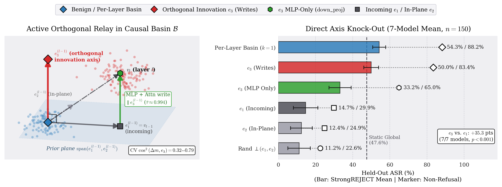
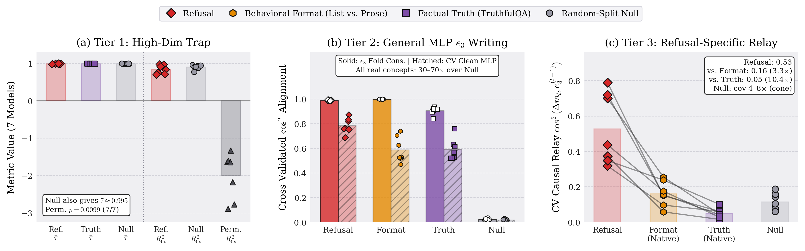
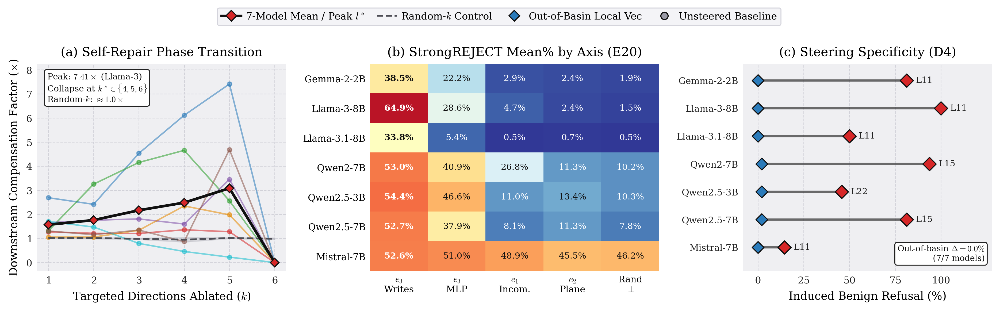

<h1 align="center">Refusal as an Active Orthogonal Relay</h1>

<p align="center">
  <em>Non-circular geometric and causal auditing of refusal in large language models.</em>
</p>

<p align="center">
  
  
  
  
  
</p>

<p align="center">
  
</p>

This repository accompanies the paper *"Refusal as an Active Orthogonal Relay:
Disentangling Causal Innovation Circuits from High-Dimensional Trajectory Drift."*
It studies how instruction-tuned LLMs sustain refusal across intermediate layers,
and separates a general architectural regularity (deterministic MLP writing along
an orthogonal innovation axis) from a refusal-specific **active orthogonal relay**
that can be causally isolated and ablated.

## Key idea

For each model we build discrete **Frenet–Serret frames** `(e1, e2, e3)` over the
per-layer refusal trajectory inside an automatically localized **Causal Basin**,
where `e1` is the incoming refusal direction, `e2` the in-plane turning axis, and
`e3` the out-of-plane *innovation* axis. Near-unit torsion turns out to be a
generic high-dimensional property (it appears even in random-split nulls), so the
method pairs analytic frames with **split-half cross-validation**,
**covariance-matched nulls**, and **layer-permutation tests** to isolate a
refusal-specific relay. Ablating only `e3` at sublayer writes removes refusal
across seven models, while in-plane and random axes do not.

## Highlights

- **A causal relay, not a static direction.** Across 7 models, each MLP write
  aligns with the previous layer's innovation axis (`cos²(Δmₗ, e3) = 0.526` mean),
  far above a covariance-matched null (**49× stronger**) and above behavioral
  (`3.3×`) and factual (`10.4×`) controls measured in their own native basins.
- **Non-circular by construction.** The `e3` axis is estimated and tested on
  disjoint folds (`cos² = 0.99` cross-fold stability), with covariance-matched
  nulls and a layer-permutation test significant on **7/7** models.
- **Targeted, utility-preserving ablation.** Knocking out only the `e3` component
  of sublayer writes collapses refusal while TruthfulQA utility stays within noise
  of baseline.
- **Reproducible without a GPU.** Committed experiment JSON plus a verifier let
  anyone re-derive every table and the paper's headline numbers offline.

### Cross-validated relay analysis (7 models)

| Model | `e3` consistency (cov-×) | Refusal relay (cov-×) | Knockout frac. |
|-------|:---:|:---:|:---:|
| Gemma-2-2B    | 0.990 (84×)  | **0.700** (20×) | 1.056 |
| Llama-3-8B    | 0.989 (209×) | **0.373** (73×) | 0.201 |
| Llama-3.1-8B  | 0.992 (88×)  | **0.318** (43×) | 0.333 |
| Qwen2-7B      | 0.990 (215×) | **0.789** (79×) | 0.902 |
| Qwen2.5-3B    | 0.993 (83×)  | **0.720** (25×) | 0.923 |
| Qwen2.5-7B    | 0.993 (148×) | **0.437** (69×) | 0.253 |
| Mistral-7B    | 0.986 (193×) | **0.348** (35×) | 0.274 |
| **Mean** | **0.990** (146×) | **0.526** (49×) | **0.563** |

<em>Relay coupling `cos²(Δmₗ, e3)` outpaces both a behavioral-format control
(3.3×) and a factual-truth control (10.4×) evaluated in their own native basins,
and a covariance-matched random-split null (4.0–7.9×).</em>

<p align="center">
  
  
</p>

## Repository layout

```
.
├── aor/                         # Python package
│   ├── interp/                  #   core primitives
│   │   ├── grassmann.py         #     Frenet frames, torsion, drift laws
│   │   ├── basin.py             #     automated Causal Basin localization
│   │   ├── reco_backend.py      #     model backend + real/stub builders
│   │   ├── reco_hooks.py        #     forward hooks + write-site ablation
│   │   ├── reco_generate.py     #     generation under intervention
│   │   ├── reco_judge.py        #     StrongREJECT / XSTest / TruthfulQA scoring
│   │   └── recovery.py          #     low-rank recovery operators
│   ├── experiments/             #   runnable experiments + orchestrator
│   │   ├── run_pipeline.py      #     one command: regenerate → export → verify
│   │   ├── exp6_geora.py, exp8_reviewer_defense.py, exp9_protocol_ablations.py, ...
│   │   ├── strengthen_stats.py, generalize_ood.py, repeated_splithalf.py
│   │   └── _stub_model.py       #     tiny transformer for offline self-tests
│   ├── plot/                    #   figures + LaTeX tables
│   │   ├── plot_figures.py
│   │   ├── export_tables.py
│   │   └── verify_tables.py     #     provenance + manuscript consistency checks
│   └── data/                    #   released data (see data/README.md)
│       ├── splits/              #     paper splits (harmful/harmless train/test)
│       └── processed/           #     OOD benchmarks (StrongREJECT, JailbreakBench)
├── results/                     # experiment JSON (committed; GPU-free verification)
├── tables/                      # exported LaTeX tables (committed; verified vs JSON)
├── figures/                     # generated figures (PNG)
├── scripts/run_pipeline.sh
├── tests/                       # offline self-tests (no GPU, no downloads)
├── docs/                        # FINALIZE.md, EXPERIMENTS.md
├── pyproject.toml, requirements.txt, LICENSE, CITATION.cff
```

## Installation

```bash
python -m venv .venv && source .venv/bin/activate
pip install -e .                 # installs the `aor` package + core deps
# StrongREJECT judge (open-weight), if not already present:
pip install "strong_reject @ git+https://github.com/alexandrasouly/strongreject.git"
```

A CUDA GPU with 24 GB (e.g. RTX 3090 Ti / RTX 4090) reproduces all seven models
in roughly 10–11 GPU-hours. The offline self-tests need neither a GPU nor network.

## Quick start

```bash
# 1) Offline wiring check (CPU only, seconds):
python -I aor/experiments/run_pipeline.py --selftest
pytest -q

# 2) Reproduce everything on a GPU (regenerate JSON → export tables → verify):
bash scripts/run_pipeline.sh         # run from the repository root

# 3) Verify the committed results back the paper's tables, no GPU required:
python -s aor/plot/verify_tables.py --root results --tables tables
```

See [`docs/FINALIZE.md`](docs/FINALIZE.md) for the full pipeline (per-model stages,
the reviewer-response experiments, and selective re-runs) and
[`docs/EXPERIMENTS.md`](docs/EXPERIMENTS.md) for notes on individual experiments.

## Data

All experiments load the released splits in `aor/data/splits/` directly, so the
results reproduce without rebuilding anything. The harmful set is a curated union
of AdvBench, MaliciousInstruct, and HarmBench, each paired with a topic- and
syntax-matched benign counterpart (minimal pairs); held-out evaluation uses a
disjoint test partition. StrongREJECT and JailbreakBench drive OOD evaluation, and
TruthfulQA / XSTest are fetched on demand. Full provenance and licensing are in
[`aor/data/README.md`](aor/data/README.md).

## Models

Gemma-2-2B-it, Llama-3-8B-Instruct, Llama-3.1-8B-Instruct, Qwen2-7B-Instruct,
Qwen2.5-3B-Instruct, Qwen2.5-7B-Instruct, and Mistral-7B-Instruct-v0.3. Weights are
fetched from the Hugging Face Hub; gated models require prior access and
`huggingface-cli login`.

## Citation

```bibtex
@inproceedings{refusal-orthogonal-relay,
  title     = {Refusal as an Active Orthogonal Relay: Disentangling Causal
               Innovation Circuits from High-Dimensional Trajectory Drift},
  author    = {Anonymous},
  year      = {2026}
}
```

## License

Released under the MIT License (see [`LICENSE`](LICENSE)). The code is intended as
a white-box diagnostic for alignment research.
# active-orthogonal-relay
